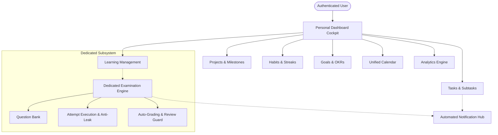

# 01. Project Overview & Product Vision

## 1. Executive Summary
**Tuntas** is an enterprise-grade, integrated productivity management and examination platform designed to harmonize daily execution, project milestone delivery, habit reinforcement, continuous learning, and formal assessment into a unified digital workspace.

Originally originating as a conventional, single-table to-do web script, Tuntas has undergone a comprehensive architectural and engineering transformation. Today, it stands as a modular **Monorepo** ecosystem separating a high-performance **Next.js 15 (React 19, TypeScript, Tailwind CSS)** frontend from a headless **Laravel 12 RESTful API** backend with multi-tenant data isolation, strict security safeguards, and a dedicated, autonomous **Examination Subsystem**.

---

## 2. Product Vision & Philosophy

### A. The Fragmentation Problem
Knowledge workers, software engineers, and university students frequently suffer from cognitive fragmentation caused by tool switching across disparate productivity apps:
- **Task Managers** for granular to-dos (e.g. Todoist, TickTick).
- **Project Roadmaps** for strategic initiatives (e.g. Jira, Linear).
- **Habit Trackers** for consistency routines (e.g. Streaks, Habitica).
- **Learning Management Systems (LMS)** for courses and study sessions (e.g. Canvas, Notion).
- **Examination Platforms** for quizzes and certification tests (e.g. Moodle, ExamSoft).
- **Calendar & Analytics Tools** for schedule planning and retrospectives.

This disjointed workflow causes lost deadlines, unfulfilled goals, fractured habits, and fragmented analytics.

### B. The Tuntas Solution
Tuntas eliminates tool fatigue by unifying these 11 critical operational pillars into a cohesive platform:
1. **Personal Command Dashboard**: Real-time cockpit synthesizing tasks, projects, streaks, exams, and velocity.
2. **Advanced Task Management**: Subtasks, recurring cadences, priorities, categories, tags, and multi-view boards (Kanban, List).
3. **Strategic Project Management**: Milestone tracking, weighted deliverable progression, and automated task-to-project rollups.
4. **Unified Calendar Aggregator**: Single-source agenda consolidating task due dates, project milestones, and exam schedules.
5. **Habit Streak & Consistency Engine**: Daily check-ins, current/best streak algorithms, and freeze token mechanics.
6. **Goal Tracking & OKRs**: Measurable targets, unit metrics, milestone checkpoints, and completion percentages.
7. **Learning Management System (LMS)**: Subject taxonomies, learning materials, and focused study session timers.
8. **Dedicated Examination Subsystem**: Autonomous exam creation, multi-type question banks, anti-leak answer sanitization, real-time autosync, and proctoring integrity monitoring.
9. **Productivity & Learning Analytics**: Deep retrospectives covering completion velocity, priority distribution, habit consistency, and grade tiers.
10. **Proactive Notification Hub**: In-app notifications with automated 24h/48h deadline scanning and deduplication.
11. **User Profile & Preference Management**: Customizable themes, timezones (WIB, WITA, WIT, UTC), avatar styles, and security settings.

---

## 3. Core Capabilities & Feature Matrix

| Functional Module | Primary Capabilities | Technical Highlights |
| :--- | :--- | :--- |
| **Authentication** | Register, Login, Token Revocation, Profile updates | Laravel Sanctum Bearer tokens, salted password hashing, multi-tenant isolation |
| **Dashboard** | Dynamic metrics rollup, today's focus, active projects, habit check-in, exam scorecard, 7-day velocity chart | Single-trip composite query, cached aggregate counters, backward-compatible DTOs |
| **Tasks** | Create, edit, delete, priority tags, status workflow, subtasks, recurring auto-generation, multi-criteria filtering | Eager-loaded relational joins, automatic recurring task spawning upon completion |
| **Projects** | Project initiatives, milestones, deadlines, status states, task assignment | Dynamic progress recalculation based on completed linked task ratios |
| **Calendar** | Monthly agenda view, event day-cells, combined calendar feeds | Aggregates tasks, projects, exams, and habit logs into a normalized `CalendarEvent` feed |
| **Habits** | Daily check-ins, frequency intervals, current streak, best streak, freeze tokens | Automatic streak rollover calculation, frozen date protection, consistency index |
| **Goals & OKRs** | Goal objectives, target values, measurement units, milestone checklists | Weighted milestone progress rollups with zero floating-point drift |
| **Learning (LMS)** | Subjects, modules, reading materials, external resources, study session timer | Tracks cumulative study minutes and session frequencies across subjects |
| **Dedicated Examination** | Exam templates, multi-type question bank, time windows, proctoring violations, autosync, auto-grading | Anti-leak option sanitization, review guard, heartbeat answer sync, standalone models |
| **Analytics** | Velocity curves, priority distribution, category breakdown, study hours, grade tiers | High-performance SQL aggregates, historical trends, visual chart breakdowns |
| **Notifications** | Notification listing, read/unread states, categories, automated deadline scanner | Heuristic $<24\text{h}$ task and $<48\text{h}$ exam scanning with 1-hour anti-spam hash |

---

## 4. Supported Use Cases & User Personas

### Persona A: Software Engineer & Technical Lead
* **Needs**: Track agile sprint tasks, manage repository milestone deadlines, record focused deep-work study sessions for certifications (e.g. AWS, CKA), and review project progress without switching platforms.
* **Workflow**:
  1. Reviews morning priorities on the **Dashboard**.
  2. Moves tasks across the **Kanban Board** (`To-Do` $\rightarrow$ `On Progress` $\rightarrow$ `In Review` $\rightarrow$ `Completed`).
  3. Uses the **Pomodoro Study Timer** in the Learning module to log 90 minutes of distributed systems reading.
  4. Checks off daily LeetCode practice on the **Habit Tracker**.

### Persona B: Student & Examination Candidate
* **Needs**: Organize coursework across subjects, access lecture notes and reading resources, track upcoming midterms/finals, and take practice quizzes under timed exam conditions.
* **Workflow**:
  1. Inspects the **Calendar** to see examination dates alongside assignment deadlines.
  2. Accesses study materials categorized by subject in the **Learning Hub**.
  3. Enters the **Dedicated Examination Interface**, completing a timed multiple-choice and short-answer test with active fullscreen proctoring.
  4. Inspects instant grading results and rationales in the **Post-Exam Review Guard** once submitted.

### Persona C: Self-Directed Continuous Learner
* **Needs**: Set quarterly career OKRs, build lasting daily habits (reading, language learning), and analyze weekly productivity velocity.
* **Workflow**:
  1. Configures measurable Key Results in **Goals & OKRs** (e.g. "Read 12 Technical Books").
  2. Checks in daily habits, using a **Freeze Token** when traveling to preserve long-term streaks.
  3. Analyzes weekly productivity metrics and study distributions in **Productivity Analytics**.
