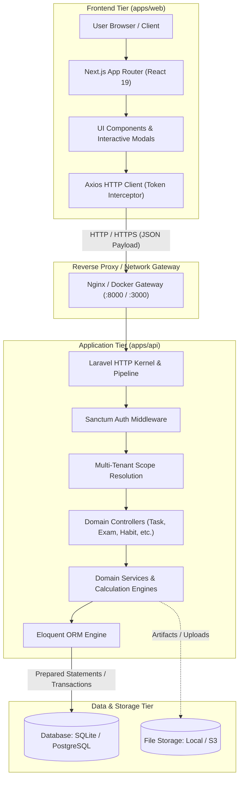
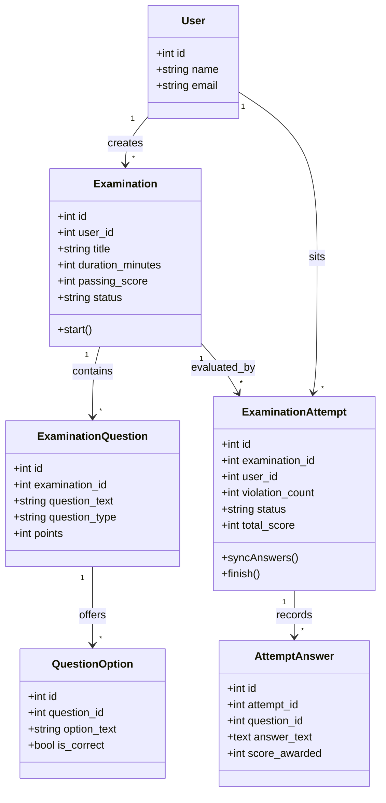

# 02. System Architecture & Monorepo Topology

## 1. Monorepo Structure & Package Responsibilities

Tuntas is built as a unified Monorepo managed via **pnpm workspaces** at the root, maintaining strict separation between presentation, application domain logic, shared data contracts, and automated validation.

```
Tuntas/
├── apps/
│   ├── web/                         # Presentation Layer: Next.js 15, React 19, TypeScript, Tailwind CSS v4
│   │   ├── src/app/                 # App Router (Route Groups: (auth), (dashboard))
│   │   │   ├── (auth)/              # Authentication screens (/login, /register)
│   │   │   ├── (dashboard)/         # Protected workspace pages (dashboard, tasks, projects, calendar, habits, goals, learning, examinations, analytics, notifications, settings)
│   │   │   ├── layout.tsx           # Global HTML root layout with font definitions
│   │   │   └── page.tsx             # Root redirect landing page
│   │   ├── src/components/          # UI Primitives & Domain Components
│   │   │   ├── layout/              # App Shell: Sidebar, Navbar, Mobile Drawer
│   │   │   └── ui/                  # Design tokens: Button, Card, Badge, Modal, Tabs, Input, AvatarStack
│   │   └── src/lib/                 # API client (Axios singleton, interceptors, formatters)
│   │
│   └── api/                         # Backend Engine: Laravel 12 Headless REST API
│       ├── app/Http/Controllers/Api # Modular RESTful API Controllers
│       ├── app/Models/              # Eloquent Domain Models (Task, Project, Examination, Habit, Goal, etc.)
│       ├── database/migrations/     # Idempotent database schema definitions
│       ├── routes/api.php           # Versioned API routes (/api/v1/...)
│       └── tests/                   # Automated Feature & Unit Test Suites (Sanctum, Multi-Tenant, Exam Security)
│
├── packages/
│   ├── types/                       # Shared TypeScript DTOs, request payloads, and entity interfaces
│   ├── ui/                          # Shared design tokens and Tailwind utility configurations
│   └── tsconfig/                    # Shared TypeScript compiler options (strict, ES2022, Next.js)
│
├── docs/                            # Exhaustive Technical Documentation & Architecture Manuals
├── docker-compose.yml               # Multi-container production deployment orchestration
├── pnpm-workspace.yaml              # Workspace definition file
└── package.json                     # Root orchestrator scripts (dev, build, lint, typecheck, test)
```

---

## 2. Layered Architecture & Request Lifecycle



### A. Presentation Tier (`apps/web`)
- **Framework**: Next.js 15 App Router with React 19 Server and Client Components.
- **State & Interactivity**: Client-side interactive states for modals, dynamic filters, drag-and-drop Kanban lanes, exam countdown timers, and autosync heartbeats.
- **Data Transportation**: Centralized Axios client (`src/lib/api.ts`) automatically injects Bearer tokens retrieved from `localStorage` into the `Authorization` header and handles global `401 Unauthorized` redirects.

### B. Application Tier (`apps/api`)
- **Framework**: Laravel 12 configured in headless API mode without traditional blade views or session cookie overhead.
- **Authentication**: Laravel Sanctum stateful token hashing. Tokens are passed via `Authorization: Bearer <token>`.
- **Tenant Scope Enforcement**: Strict multi-tenant isolation. All controller queries bind strictly to `$request->user()->id`. Access attempts across tenants yield an explicit `403 Forbidden` response.
- **Response Standardization**: Unified JSON envelope schema:
  - Success: `{ "success": true, "data": { ... }, "message": "..." }`
  - Failure: `{ "success": false, "message": "...", "errors": [ ... ] }`

---

## 3. Dedicated Examination Subsystem Boundary Isolation

A paramount architectural principle of Tuntas is that the **Examination System is an autonomous subsystem** rather than an add-on field to the task table.



### Subsystem Guarantees:
1. **Independent Domain Entities**: Standalone schema migrations, models, controllers, and database tables (`examinations`, `examination_questions`, `question_options`, `examination_attempts`, `attempt_answers`).
2. **Anti-Leak Security Boundary**: Active attempts receive sanitized question models with `is_correct` flags and rationale explanations stripped from API serialization.
3. **Dedicated Real-Time Sync**: Isolated endpoint `/api/v1/examinations/attempts/{id}/sync` running independent periodic heartbeats without interfering with regular task polling.
4. **Post-Exam Review Guard**: Detailed grading explanations and solution walkthroughs are strictly walled off until the attempt status transitions to `completed`.

---

## 4. Architectural Decision Records (ADRs)

### ADR-01: Adoption of Monorepo Architecture
- **Status**: Approved & Implemented.
- **Context**: The original repository had a loose frontend and backend without shared contracts, leading to diverging API schemas.
- **Decision**: Adopt a pnpm workspace monorepo uniting `@tuntas/web`, `@tuntas/api`, `@tuntas/types`, and `@tuntas/ui`.
- **Consequences**: Single repository checkout, atomic cross-tier commits, unified versioning, and zero-drift TypeScript contracts.

### ADR-02: Next.js 15 App Router & React 19 for Presentation
- **Status**: Approved & Implemented.
- **Context**: The legacy frontend used React with client-side script tags and custom routers with frequent hydration and performance issues.
- **Decision**: Migrate to Next.js 15 App Router utilizing route groups `(auth)` and `(dashboard)`, TypeScript 5.8, and Tailwind CSS v4.
- **Consequences**: Clean separation of authenticated layouts, zero flash of unauthenticated content, instant static compilation for 15+ pages, and sub-105 kB initial JavaScript payload.

### ADR-03: Laravel 12 Headless RESTful API with Sanctum
- **Status**: Approved & Implemented.
- **Context**: Needed an enterprise-grade backend with robust ORM, schema migrations, and high developer ergonomics for database integrity.
- **Decision**: Standardize on Laravel 12 with Sanctum token authentication, exposing pure JSON REST endpoints under `/api/v1`.
- **Consequences**: Rapid schema evolutions with migrations, multi-tenant query safety via Eloquent scopes, robust feature testing via PHPUnit, and simple deployment.

### ADR-04: Strict Anti-Leak Examination Assessment Engine
- **Status**: Approved & Implemented.
- **Context**: Examination platforms must prevent students from inspecting correct answers via browser DevTools or Network tabs.
- **Decision**: Never send `is_correct` booleans or `explanation` text to client during ongoing attempts. Grade entirely on server; gate `/review` endpoint strictly until attempt completion.
- **Consequences**: Zero client-side cheat potential; tamper-proof score computations.

### ADR-05: Database Compatibility (SQLite WAL & PostgreSQL)
- **Status**: Approved & Implemented.
- **Context**: Local development and small-scale deployments need zero-setup SQLite, while enterprise production requires PostgreSQL.
- **Decision**: Write all migrations and queries using standard Eloquent conventions compatible with SQLite 3 (WAL mode) and PostgreSQL 14+.
- **Consequences**: Seamless local testing (`Duration: <2s` for 35 tests) and effortless one-click production scalability to RDS/Cloud SQL.
