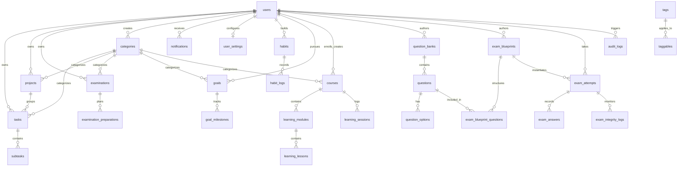

# 03. Skema Basis Data & ERD (Database Schema & ERD)

## 1. Overview Arsitektur Basis Data

Basis data **Tuntas** dirancang menggunakan prinsip **Normalisasi Ketiga (3NF)** dengan batasan domain (*bounded contexts*) yang tegas. Modul ujian (*Dedicated Examination Subsystem*) memiliki model data independen dan terisolasi dari modul task management standar.

Sistem mendukung SQLite untuk local development/CI and MySQL 8.0+ / PostgreSQL 15+ untuk environment produksi enterprise.

---

## 2. Complete Entity Relationship Diagram (ERD)

---

## 3. Rincian Tabel dan Kamus Data

### A. Core Management (`users`, `user_settings`, `categories`, `tags`)
1. `users`: Entitas autentikasi utama (`id`, `name`, `email`, `password`, `role`, `timezone`, `avatar`).
2. `user_settings`: Preferensi konfigurasi akun (`user_id`, `theme`, `email_notifications`, `in_app_notifications`, `daily_digest`, `timezone`, `preferences`).
3. `categories`: Kategori warna dan ikon untuk pengelompokan lintas modul.
4. `tags` & `taggables`: Penanda polimorfik banyak-ke-banyak untuk fleksibilitas tagging.

### B. Task & Project Management
1. `projects`: Wadah proyek dengan milestone dan kalkulasi otomatis persentase (`start_date`, `deadline`, `status`, `priority`, `progress`).
2. `tasks`: Tugas utama dengan metadata lengkap (`status`, `priority`, `due_date`, `reminder_at`, `is_recurring`, `order`).
3. `subtasks`: Item checklist turunan dari task utama.

### C. Habit Tracking (Streak Engine)
1. `habits`: Entitas kebiasaan dengan frekuensi (`daily`, `weekdays`, `weekly`), target numerik, freeze token balance, dan penghitung `current_streak` & `best_streak`.
2. `habit_logs`: Riwayat harian penyelesaian kebiasaan (`log_date`, `value`, `is_completed`, `used_freeze`, `notes`). Indeks unik pada `['habit_id', 'log_date']`.

### D. Goal Management (OKRs)
1. `goals`: Sasaran jangka panjang (`start_date`, `target_date`, `status`, `progress`).
2. `goal_milestones`: Key results terukur dengan metrik target dan nilai aktual (`target_value`, `current_value`, `unit`, `is_completed`). Progres goal dikalkulasi otomatis saat milestone diperbarui.

### E. Learning Management (LMS)
1. `courses`: Kursus atau silabus pembelajaran dengan kalkulasi persentase kelulusan.
2. `learning_modules`: Bab/modul terurut dalam sebuah kursus.
3. `learning_lessons`: Materi pelajaran spesifik dengan perkiraan durasi dan status penyelesaian.
4. `learning_sessions`: Jurnal sesi belajar pengguna (`topic`, `duration_minutes`, `session_date`, `notes`).

---

## 4. Dedicated Examination Subsystem Engine

Modul Examination memiliki dua aspek:
1. **Aspek Operasional & Persiapan** (`examinations` & `examination_preparations`):
   - Mencatat jadwal ujian eksternal (UTBK, sertifikasi AWS, ujian kampus), durasi, platform pelaksanaan, dan checklist rencana belajar.
2. **Aspek Assessment Engine Autentik** (`question_banks`, `questions`, `question_options`, `exam_blueprints`, `exam_attempts`, `exam_answers`, `exam_integrity_logs`):
   - **Question Bank & Bank Soal**: Mendukung tipe soal `multiple_choice_single`, `multiple_choice_multiple`, `true_false`, `short_answer`, `essay`, dan `code_analysis`.
   - **Exam Blueprint**: Definisi ujian terstruktur (durasi, skor kelulusan, opsi pengacakan urutan soal dan pilihan jawaban, batas percobaan).
   - **Exam Attempt (Sesi Ujian)**:
     - Primary key bertipe **UUID v4** untuk keamanan ID tanpa auto-increment enumeration.
     - Kolom `questions_snapshot` (JSON): Menyimpan snapshot instan susunan soal saat ujian dimulai untuk menjaga konsistensi historis meskipun bank soal diedit di masa depan.
     - **Pemberlakuan Timer Otoritatif di Server**: Kolom `expires_at` ditentukan secara mutlak oleh server (`now() + duration_minutes`). Request auto-save (`sync`) dan submit yang melampaui `expires_at` akan ditolak dengan kode **HTTP 410 (Gone / Expired)**.
   - **Keamanan Soal & Kunci Jawaban**: Kolom `is_correct` dan `explanation` **tidak pernah diserialisasikan** dalam sesi ujian yang sedang aktif (`in_progress`). Hanya dirilis saat siswa mengakses telaah pasca-penyerahan (`review`).
   - **Exam Integrity Logs**: Merekam peringatan anti-curang saat sesi ujian berlangsung (`tab_switch`, `window_blur`, `fullscreen_exit`, `paste_detected`).

---

## 5. Indeks & Optimalisasi Kinerja Basis Data

1. **Composite Indexes**:
   - `tasks`: `['user_id', 'status']`, `['user_id', 'due_date']`
   - `examinations`: `['user_id', 'examination_date']`, `['user_id', 'status']`
   - `habits`: `['user_id', 'is_archived']`
   - `habit_logs`: `['user_id', 'log_date']`, Unique constraint pada `['habit_id', 'log_date']`
   - `goals`: `['user_id', 'status']`
   - `exam_attempts`: `['user_id', 'status']`, `['exam_blueprint_id', 'user_id']`
   - `audit_logs`: `['user_id', 'action']`
2. **Database Transactions**: Seluruh operasi multi-tabel (seperti penyerahan ujian + penilaian otomatis, pembaruan milestone goal, toggle kebiasaan + streak recompute) dibungkus dalam `DB::transaction()` demi menjamin kepatuhan ACID.
