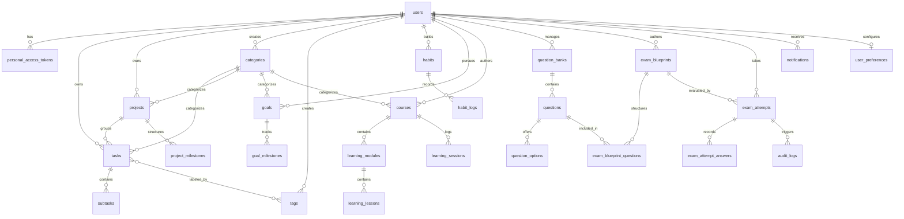

# 04. Database Schema & Entity Relationship Diagram (ERD)

## 1. Relational Database Overview

The **Tuntas** data layer is structured in strict Third Normal Form (3NF) across multiple cohesive domain boundaries. All tables are created via versioned, idempotent Laravel migrations compatible with both **SQLite 3** and **PostgreSQL 14+**.

---

## 2. Comprehensive Entity Data Dictionary

### A. Authentication & User Profile Domain

#### `users`
| Column | Type | Constraints | Description |
| :--- | :--- | :--- | :--- |
| `id` | `BIGINT UNSIGNED` | Primary Key, Auto Increment | Unique user identifier |
| `name` | `VARCHAR(255)` | Not Null | User full name |
| `email` | `VARCHAR(255)` | Not Null, Unique | Email address used for authentication |
| `password` | `VARCHAR(255)` | Not Null | Bcrypt hashed password |
| `remember_token` | `VARCHAR(100)` | Nullable | Session remember token |
| `created_at` / `updated_at`| `TIMESTAMP` | Nullable | Standard timestamps |

#### `user_preferences`
| Column | Type | Constraints | Description |
| :--- | :--- | :--- | :--- |
| `id` | `BIGINT UNSIGNED` | Primary Key | Preference identifier |
| `user_id` | `BIGINT UNSIGNED` | Foreign Key $\rightarrow$ `users(id)` ON DELETE CASCADE | Associated user |
| `theme` | `VARCHAR(50)` | Default `'dark'` | UI theme mode (`light`, `dark`, `system`) |
| `timezone` | `VARCHAR(50)` | Default `'Asia/Jakarta'` | User timezone offset for deadlines |
| `notification_settings` | `JSON` | Nullable | JSON flags for email and in-app alerts |

---

### B. Core Productivity Domain (Tasks, Projects, Categories, Tags)

#### `categories`
| Column | Type | Constraints | Description |
| :--- | :--- | :--- | :--- |
| `id` | `BIGINT UNSIGNED` | Primary Key | Category identifier |
| `user_id` | `BIGINT UNSIGNED` | Foreign Key $\rightarrow$ `users(id)` ON DELETE CASCADE | Owner |
| `name` | `VARCHAR(255)` | Not Null | Category title |
| `color` | `VARCHAR(30)` | Default `'#6366F1'` | Hex color token for visual badge |
| `icon` | `VARCHAR(50)` | Nullable | Lucide icon identifier |

#### `projects`
| Column | Type | Constraints | Description |
| :--- | :--- | :--- | :--- |
| `id` | `BIGINT UNSIGNED` | Primary Key | Project identifier |
| `user_id` | `BIGINT UNSIGNED` | Foreign Key $\rightarrow$ `users(id)` ON DELETE CASCADE | Project owner |
| `category_id` | `BIGINT UNSIGNED` | Nullable, Foreign Key $\rightarrow$ `categories(id)` | Optional category |
| `name` | `VARCHAR(255)` | Not Null | Project title |
| `description` | `TEXT` | Nullable | Detailed scope of the project |
| `color` | `VARCHAR(30)` | Default `'#6366F1'` | Accent color |
| `status` | `VARCHAR(50)` | Default `'active'` | `'active'`, `'completed'`, `'archived'` |
| `deadline` | `DATE` | Nullable | Final project completion target |
| `progress_percentage` | `INTEGER` | Default `0` | Dynamic rollup ($0-100\%$) |

#### `tasks`
| Column | Type | Constraints | Description |
| :--- | :--- | :--- | :--- |
| `id` | `BIGINT UNSIGNED` | Primary Key | Task identifier |
| `user_id` | `BIGINT UNSIGNED` | Foreign Key $\rightarrow$ `users(id)` ON DELETE CASCADE | Owner |
| `project_id` | `BIGINT UNSIGNED` | Nullable, Foreign Key $\rightarrow$ `projects(id)` ON DELETE SET NULL | Optional project grouping |
| `category_id` | `BIGINT UNSIGNED` | Nullable, Foreign Key $\rightarrow$ `categories(id)` ON DELETE SET NULL | Optional category |
| `title` | `VARCHAR(255)` | Not Null | Actionable task name |
| `description` | `TEXT` | Nullable | Task details and markdown notes |
| `priority` | `VARCHAR(20)` | Default `'medium'` | `'low'`, `'medium'`, `'high'`, `'urgent'` |
| `status` | `VARCHAR(20)` | Default `'todo'` | `'todo'`, `'in_progress'`, `'in_review'`, `'completed'`, `'cancelled'` |
| `due_date` | `DATE` | Nullable | Task deadline |
| `due_time` | `TIME` | Nullable | Specific due hour |
| `is_recurring` | `BOOLEAN` | Default `false` | Recurring schedule flag |
| `recurrence_pattern` | `VARCHAR(50)` | Nullable | `'daily'`, `'weekly'`, `'monthly'` |
| `completed_at` | `TIMESTAMP` | Nullable | Timestamp of completion |

#### `subtasks`
| Column | Type | Constraints | Description |
| :--- | :--- | :--- | :--- |
| `id` | `BIGINT UNSIGNED` | Primary Key | Subtask identifier |
| `task_id` | `BIGINT UNSIGNED` | Foreign Key $\rightarrow$ `tasks(id)` ON DELETE CASCADE | Parent task |
| `title` | `VARCHAR(255)` | Not Null | Checklist item name |
| `is_completed` | `BOOLEAN` | Default `false` | Completion flag |
| `order_index` | `INTEGER` | Default `0` | Sorting sequence |

---

### C. Habit & Goal Domain

#### `habits`
| Column | Type | Constraints | Description |
| :--- | :--- | :--- | :--- |
| `id` | `BIGINT UNSIGNED` | Primary Key | Habit identifier |
| `user_id` | `BIGINT UNSIGNED` | Foreign Key $\rightarrow$ `users(id)` ON DELETE CASCADE | Owner |
| `title` | `VARCHAR(255)` | Not Null | Habit action title |
| `frequency` | `VARCHAR(50)` | Default `'daily'` | Cadence (`daily`, `weekly`) |
| `current_streak` | `INTEGER` | Default `0` | Current consecutive day count |
| `best_streak` | `INTEGER` | Default `0` | Historical highest streak |
| `freeze_tokens` | `INTEGER` | Default `2` | Missed day protection credits |

#### `habit_logs`
| Column | Type | Constraints | Description |
| :--- | :--- | :--- | :--- |
| `id` | `BIGINT UNSIGNED` | Primary Key | Log record ID |
| `habit_id` | `BIGINT UNSIGNED` | Foreign Key $\rightarrow$ `habits(id)` ON DELETE CASCADE | Associated habit |
| `log_date` | `DATE` | Not Null | Execution date |
| `status` | `VARCHAR(20)` | Default `'completed'` | `'completed'`, `'skipped'`, `'frozen'` |

#### `goals` & `goal_milestones`
- `goals`: Tracks overarching objectives, target dates, target values, measurement units (e.g. `Pages`, `Hours`, `Repos`), and status.
- `goal_milestones`: Discrete checkpoints with target values that rollup into the parent goal's progress percentage.

---

### D. Dedicated Learning Management Domain (LMS)

#### `courses` & `learning_modules` & `learning_lessons`
- Hierarchical structure: Courses contain Modules, which contain Lessons.
- `learning_lessons` store lesson titles, textual notes, reading content, and external reference URLs (`resource_url`).

#### `learning_sessions`
| Column | Type | Constraints | Description |
| :--- | :--- | :--- | :--- |
| `id` | `BIGINT UNSIGNED` | Primary Key | Session identifier |
| `user_id` | `BIGINT UNSIGNED` | Foreign Key $\rightarrow$ `users(id)` ON DELETE CASCADE | Student |
| `course_id` | `BIGINT UNSIGNED` | Foreign Key $\rightarrow$ `courses(id)` ON DELETE CASCADE | Course |
| `duration_minutes` | `INTEGER` | Not Null | Focused study duration |
| `notes` | `TEXT` | Nullable | Retrospective study log |
| `created_at` | `TIMESTAMP` | Not Null | Date of session |

---

### E. Dedicated Examination Subsystem Domain

#### `question_banks` & `questions` & `question_options`
- `question_banks`: Categorized repositories of reusable assessment questions.
- `questions`: Holds question prompts, points weight, explanation rationales, and question types:
  - `multiple_choice`: Single or multi-answer selections.
  - `single_choice`: Radio single-select.
  - `true_false`: Boolean assertion.
  - `short_answer`: Text match validation.
  - `essay`: Qualitative submission.
- `question_options`: Individual answer options with `option_text`, `is_correct` boolean, and optional `weight`.

#### `exam_blueprints`
| Column | Type | Constraints | Description |
| :--- | :--- | :--- | :--- |
| `id` | `BIGINT UNSIGNED` | Primary Key | Exam identifier |
| `user_id` | `BIGINT UNSIGNED` | Foreign Key $\rightarrow$ `users(id)` ON DELETE CASCADE | Examiner |
| `course_id` | `BIGINT UNSIGNED` | Nullable, Foreign Key $\rightarrow$ `courses(id)` | Linked LMS course |
| `title` | `VARCHAR(255)` | Not Null | Examination title |
| `duration_minutes`| `INTEGER` | Not Null | Total countdown minutes |
| `passing_score` | `INTEGER` | Default `70` | Passing threshold percentage |
| `max_attempts` | `INTEGER` | Default `1` | Allowed student attempts |
| `starts_at` / `ends_at` | `TIMESTAMP` | Nullable | Scheduled availability window |
| `status` | `VARCHAR(30)` | Default `'draft'` | `'draft'`, `'published'`, `'archived'` |

#### `exam_attempts` & `exam_attempt_answers`
- `exam_attempts`: Tracks active test instances, `started_at`, `finished_at`, `total_score`, `is_passed`, `violation_count`, and status (`in_progress`, `completed`, `timed_out`, `abandoned`).
- `exam_attempt_answers`: Stores student's selected option IDs or textual inputs, auto-graded score, and timestamp.

