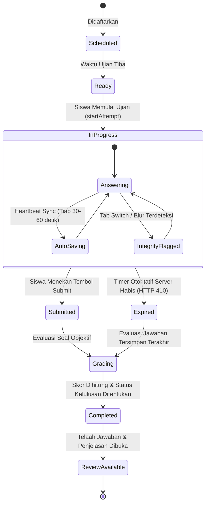

# 05. Dedicated Examination Subsystem Architecture & Specification

## 1. Visi dan Batasan Domain (Domain Boundaries)

Modul **Examination** pada Tuntas **bukanlah** sekadar item to-do list atau task biasa dengan kolom tanggal. Examination merupakan **sub-sistem otonom** (*bounded context*) yang memiliki basis data, model domain, alur kerja penilaian, serta mekanisme keamanan dan integritas tersendiri.

Sistem Examination terbagi menjadi dua pilar:
1. **Pilar Perencanaan & Penjadwalan Ujian (Operational Examination)**:
   - Manajemen jadwal ujian eksternal (UTBK, sertifikasi industri, ujian akhir semester).
   - Pengingat waktu, platform pelaksanaan, dan rencana belajar (*preparation checklists*).
2. **Pilar Asesmen & Penilaian Otonom (Assessment Engine)**:
   - Bank soal (*question banks*) dengan beragam jenis pertanyaan.
   - Konfigurasi blueprint ujian dengan aturan pengacakan dan timer server.
   - Pelaksanaan ujian (*exam attempt*) dengan snapshot soal yang tidak berubah (*immutable*).
   - Penilaian otomatis (*auto-grading engine*).
   - Pencatatan integritas ujian (*anti-cheat proctoring logs*).

---

## 2. State Machine Sesi Ujian (Exam Attempt Lifecycle)

---

## 3. Tipe Pertanyaan yang Didukung

| Tipe Soal | Kode Enum | Metode Penilaian |
| :--- | :--- | :--- |
| **Pilihan Ganda Tunggal** | `multiple_choice_single` | Otomatis: Membandingkan ID opsi terpilih dengan opsi `is_correct == true`. |
| **Pilihan Ganda Jamak** | `multiple_choice_multiple` | Otomatis: Membandingkan himpunan ID opsi terpilih dengan seluruh opsi `is_correct == true`. |
| **Benar / Salah** | `true_false` | Otomatis: Pencocokan boolean instan. |
| **Isian Singkat** | `short_answer` | Otomatis: Pencocokan teks ter-normalisasi (*trimmed, case-insensitive*) terhadap opsi kunci. |
| **Analisis Kode** | `code_analysis` | Menampilkan potongan kode (*code snippet*) dengan penyorotan sintaks; dinilai objektif atau manual. |
| **Esai / Uraian** | `essay` | Evaluasi manual oleh instruktur atau bantuan model evaluasi. |

---

## 4. Mekanisme Penilaian & Skoring Otoritatif

Penilaian dilakukan sepenuhnya di sisi server (*server-authoritative*):
1. **Total Nilai Maksimal ($P_{\text{possible}}$)**:
   $$P_{\text{possible}} = \sum_{i=1}^{N} \text{points}_i$$
2. **Total Nilai Perolehan ($P_{\text{earned}}$)**:
   $$P_{\text{earned}} = \sum_{i=1}^{N} \text{awarded\_points}_i$$
3. **Persentase Skor Akhir**:
   $$\text{Score \%} = \begin{cases} 0\% & \text{jika } P_{\text{possible}} = 0 \\ \operatorname{round}\left(\frac{P_{\text{earned}}}{P_{\text{possible}}} \times 100, 2\right) & \text{jika } P_{\text{possible}} > 0 \end{cases}$$
4. **Status Kelulusan**:
   $$\text{is\_passed} = (\text{Score \%} \ge \text{passing\_score})$$

---

## 5. Mekanisme Keamanan & Integritas Ujian

### A. Pencegahan Kebocoran Kunci Jawaban
- Saat siswa memanggil `POST /api/v1/exam-blueprints/{id}/start`, backend mengompilasi `questions_snapshot`.
- Properti `is_correct` pada tabel `question_options` dan teks `explanation` pada tabel `questions` **secara ketat disaring dan dihapus** sebelum snapshot dikirim ke browser.
- Siswa tidak dapat menemukan jawaban benar melalui pemeriksaan Network Tab ataupun inspeksi state JavaScript frontend.

### B. Otoritas Timer di Sisi Server & Penanganan Rekoneksi
- Durasi ujian dihitung secara mutlak di sisi server: `expires_at = now() + duration_minutes`.
- Timer pada browser hanya bertindak sebagai representasi visual untuk pengguna.
- **Toleransi Terputus (Reconnect Safe)**: Jika tab browser ditutup atau koneksi internet terputus di tengah sesi yang masih aktif, pemanggilan `startAttempt` kembali akan memulihkan sesi `in_progress` yang sama beserta jawaban yang sudah tersimpan tanpa mengulang waktu atau membuat duplikat attempt.
- Setiap pemanggilan sinkronisasi jawaban (`POST /api/v1/exam-attempts/{id}/sync`) memvalidasi `Carbon::now() <= expires_at`.
- Jika waktu telah habis, server langsung menandai status attempt sebagai `expired` dan menolak payload dengan respon **HTTP 410 (Gone / Expired)**.

### C. Anti-Cheat Integrity Proctoring
- Frontend Next.js memantau perilaku window browser:
  1. `visibilitychange` (perpindahan tab atau minimize window).
  2. `window.onblur` (fokus beralih ke aplikasi lain).
  3. `fullscreenchange` (keluar dari mode layar penuh).
  4. `paste` (upaya menyalin teks jawaban dari luar).
- Setiap kejadian dikirim ke backend melalui `POST /api/v1/exam-attempts/{id}/integrity` dan dicatat ke tabel `exam_integrity_logs` beserta timestamp presisi.
- Hasil ringkasan integritas disajikan kepada instruktur pada laporan telaah ujian pasca-penyerahan.

### D. Immutability Snapshot Soal
- Perubahan atau penghapusan soal di bank soal setelah ujian dimulai **tidak akan merusak** atau mengubah soal pada sesi ujian yang sedang berjalan maupun riwayat ujian lampau, karena setiap attempt memegang salinan mandiri di kolom `questions_snapshot`.

### E. Batasan Integritas Praktis (Realistic Security Model)
Sistem integritas Tuntas dirancang secara transparan:
- **Melindungi dari**: Akses kunci jawaban pra-evaluasi, manipulasi skor di client, penyerahan di luar batas waktu server, kecurangan tab-switching lokal, dan duplikasi submisi melebihi `max_attempts`.
- **Batasan**: Sebagai aplikasi web tanpa native OS-level lock (seperti Safe Exam Browser), sistem tidak dapat mendeteksi keberadaan monitor kedua perangkat keras terpisah atau perangkat seluler eksternal tanpa pengawasan video webcam fisik.

---

## 6. Integrasi Learning Management System (LMS) & Examination

Meskipun logika bisnis dan model domain terpisah secara ketat, integrasi lintas domain dilakukan secara terpadu:
1. **Asosiasi Blueprint dengan Subject**:
   - Blueprint ujian memiliki relasi opsional `course_id` yang menghubungkannya ke mata pelajaran/kursus pada modul LMS.
2. **Rollup Analitik Belajar**:
   - Endpoint `/api/v1/learning-analytics` merangkum riwayat ujian terselesaikan yang terkait dengan mata pelajaran pengguna untuk menampilkan korelasi antara waktu belajar (*study sessions duration*) dengan perolehan skor ujian (*exam scorecard*).
3. **Pemisahan Sesi Belajar vs Ujian**:
   - Sesi belajar mandiri dicatat pada `learning_sessions` untuk melacak fokus harian, sedangkan pengerjaan ujian dicatat secara formal pada `exam_attempts`.
