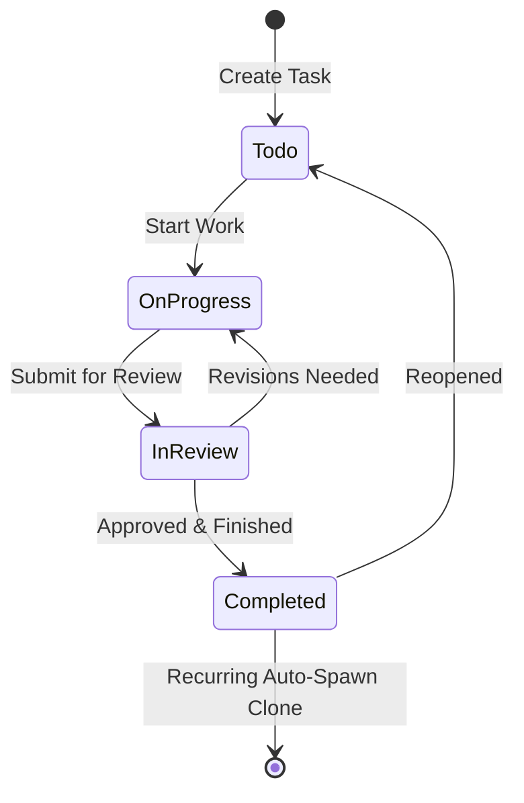
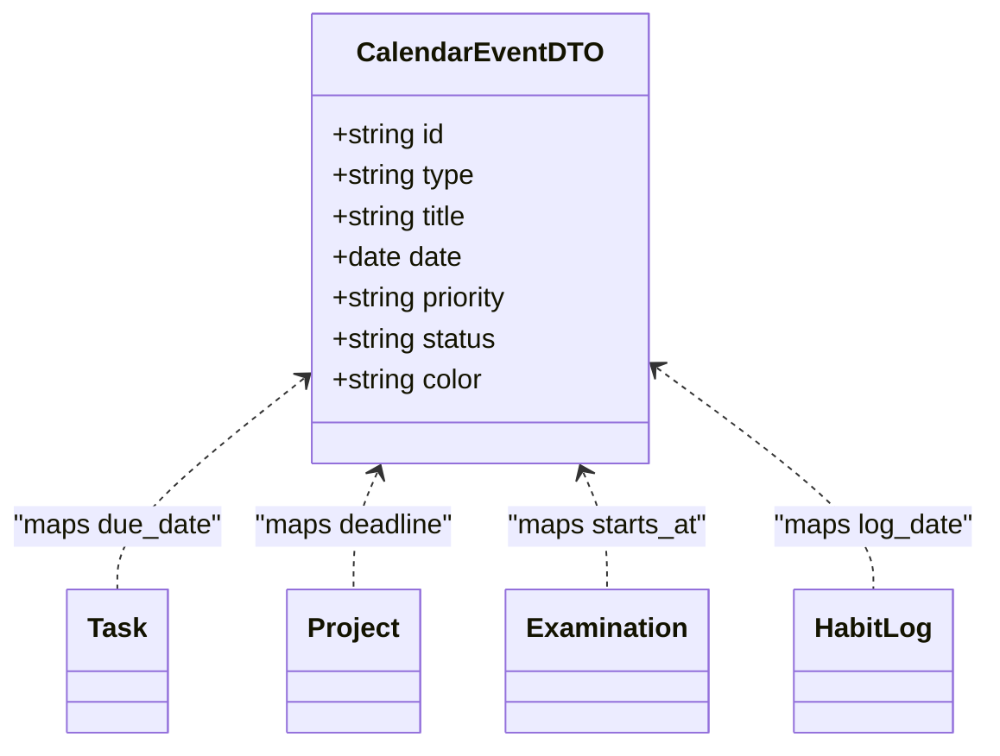

# 06. Core Functional Modules Specification

This document details the functional specifications, data models, state machines, and calculations powering the 11 integrated modules of the **Tuntas** platform.

---

## 1. Personal Command Dashboard
The Dashboard serves as the executive summary cockpit synthesizing user productivity and academic data across domains.

### Data Aggregation Pipeline (`DashboardController@index`)
- **Summary Metrics**: Real-time counter of total tasks, completed tasks, pending tasks, and overdue tasks.
- **Velocity Curve (7 Days)**: Daily task completions computed over the preceding 7 calendar days:
  $$\text{Velocity}(d) = \sum_{t \in \text{Tasks}} \mathbb{I}(\text{status}(t) = \text{'completed'} \land \text{date}(\text{completed\_at}(t)) = d)$$
- **Today's Priorities**: Top 5 urgent/high priority tasks due on or before current date.
- **Active Projects**: Projects with status `active` showing calculated progress bars.
- **Habit Daily Check-in**: Habits showing completion state for the current day.
- **Upcoming Examinations**: Published exams within the next 14 days.

---

## 2. Advanced Task Management
Implements enterprise-grade workflow execution across 4 Kanban lanes (`To-Do`, `On Progress`, `In Review`, `Completed`).

### A. Lifecycle State Transitions

### B. Recurring Tasks Engine
When a task with `is_recurring = true` transitions to `completed`:
1. Current record is frozen as `completed` with timestamp `completed_at` to preserve historical productivity metrics.
2. The controller automatically clones a new instance:
   - Sets `due_date` to $D + \Delta$ where $\Delta \in \{+1\text{ day}, +7\text{ days}, +1\text{ month}\}$.
   - Resets status to `todo`.
   - Duplicates all subtasks with `is_completed = false`.
   - Preserves category, project association, and priority.

### C. Subtask Completion Calculation
$$\text{Subtask Ratio} = \frac{\sum \mathbb{I}(\text{subtask.is\_completed} = \text{true})}{\text{Total Subtasks}} \times 100\%$$

---

## 3. Project Management & Progress Engine
Enables tracking of strategic initiatives with dynamic progress recalculation.

### Deterministic Progress Calculation
$$\text{Project Progress} = \text{round}\left( \frac{\sum_{t \in \text{ProjectTasks}} \mathbb{I}(\text{status}(t) = \text{'completed'})}{|\text{ProjectTasks}|} \times 100 \right)$$
- If the project contains no tasks, progress defaults to `0%` or reflects manual milestone completions.
- Automatically updates whenever a linked task is created, updated, status-toggled, or deleted.

---

## 4. Unified Calendar Aggregator
Aggregates heterogeneous date-driven events into a normalized monthly/weekly view.

### Event Normalization Mapping

---

## 5. Habit & Consistency Engine
Builds long-term habits using atomic daily check-ins, continuous streaks, and freeze token protection.

### Streak Calculation Algorithm
- **Continuous Streak**: Count of consecutive calendar days with `status = 'completed'` or `status = 'frozen'`.
- **Missed Day Handling**:
  - If a user misses day $D$, but has `freeze_tokens > 0`, they can redeem a freeze token:
    $$\text{freeze\_tokens} \leftarrow \text{freeze\_tokens} - 1, \quad \text{Log}(D) \leftarrow \text{'frozen'}$$
  - If no token is redeemed and a gap $>1$ day exists, `current_streak` resets to `0`.
- **Best Streak**:
  $$\text{best\_streak} \leftarrow \max(\text{best\_streak}, \text{current\_streak})$$

---

## 6. Goal Tracking & OKR Engine
Manages quarterly objectives and key results with custom units of measure.

### Milestone Weighted Progress
Each milestone has `current_value` and `target_value`:
$$\text{Milestone Progress}_i = \min\left(100, \frac{\text{current\_value}_i}{\text{target\_value}_i} \times 100\right)$$
$$\text{Goal Progress} = \frac{1}{N} \sum_{i=1}^N \text{Milestone Progress}_i$$

---

## 7. Dedicated Learning Management System (LMS)
Structured knowledge repository linking Courses, Modules, Lessons, and Study Sessions.

- **Content Organization**: Hierarchical Course $\rightarrow$ Module $\rightarrow$ Lesson taxonomy.
- **Reading Resources**: Direct external links to reference PDFs, docs, and git repos.
- **Focused Study Session Timer**: Built-in Pomodoro timer logging focused minutes to `learning_sessions`.

---

## 8. Dedicated Examination Subsystem
*(Detailed exhaustively in `docs/07-dedicated-examination-system.md`)*
Autonomous subsystem supporting question banks, multi-type questions, timer locks, anti-leak answer sanitization, real-time autosync, proctoring violations, and auto-grading.

---

## 9. Productivity & Learning Analytics
- **Productivity Analytics (`GET /api/v1/analytics/productivity`)**:
  - Task completion velocity by day and week.
  - Distribution by priority (`urgent`, `high`, `medium`, `low`) and category.
  - Project milestone delivery rates.
  - Habit consistency score:
    $$\text{Consistency} = \frac{\text{Total Logged Days}}{\text{Total Active Days}} \times 100\%$$
- **Learning Analytics (`GET /api/v1/analytics/learning`)**:
  - Total study hours and session frequencies by subject.
  - Exam pass rates and average scores.
  - 4-Tier grade distribution ($85-100\%$, $70-84\%$, $50-69\%$, $<50\%$).

---

## 10. Automated Notification Engine & Deadline Scanner
- **Categorized In-App Alerts**: Filterable by `all`, `deadlines`, `exams`, `habits`, and `system`.
- **Automated Deadline Scanner (`POST /api/v1/notifications/check-reminders`)**:
  - Scans tasks due in $<24\text{ hours}$.
  - Scans scheduled examinations starting in $<48\text{ hours}$.
  - Computes deterministic hash `md5(user_id + type + target_id + today)` to ensure zero duplicate notifications within a 24-hour cycle.

---

## 11. User Management & Security Settings
- **Profile Updates**: Name, email, and avatar customization.
- **Timezone Customization**: Supports Indonesian (`WIB`, `WITA`, `WIT`) and international (`UTC`, `PST`, `EST`) timezones for deadline alerts.
- **Security**: Current password validation and salt updates.
- **Multi-Tenant Protection**: Strict tenant isolation across all tables.
