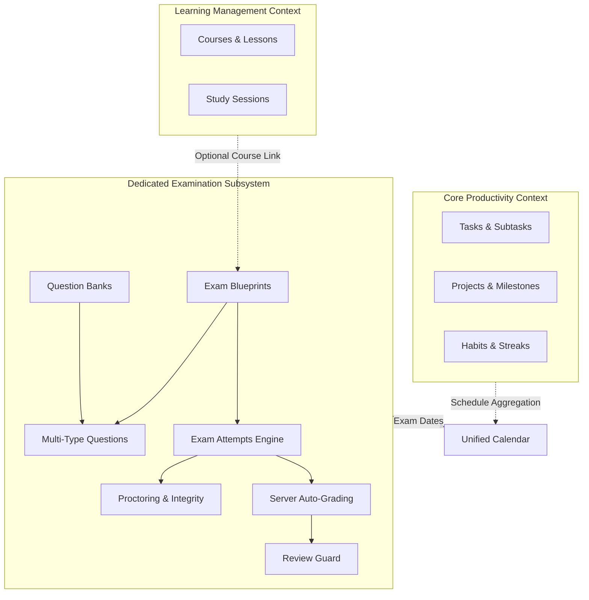
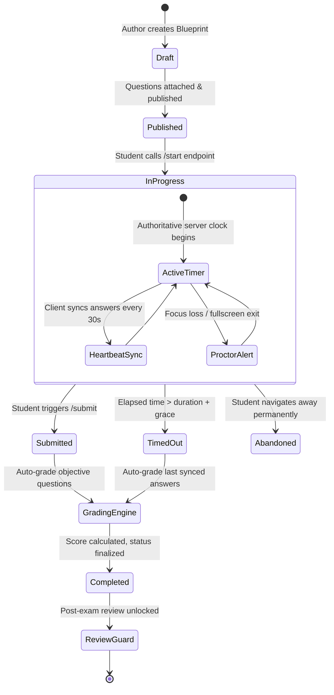

# 07. Dedicated Examination Subsystem Manual

## 1. Domain Boundaries & Architectural Independence

The **Examination Subsystem** in Tuntas is architected as an autonomous bounded context. Unlike traditional to-do applications that treat exams merely as scheduled calendar events, Tuntas provides an independent assessment subsystem featuring dedicated models, business services, security controls, and frontend interactive runners.

---

## 2. Complete Attempt Lifecycle State Machine

---

## 3. Supported Question Types & Auto-Grading Algorithms

| Question Type | Identifier | Evaluation Mechanism |
| :--- | :--- | :--- |
| **Multiple Choice (Single)** | `single_choice` | Evaluates if selected option ID matches the single option with `is_correct = true`. |
| **Multiple Choice (Multi)** | `multiple_choice` | Evaluates if the set of selected option IDs exactly matches the set of correct options. |
| **True / False** | `true_false` | Boolean comparison against the designated key option. |
| **Short Answer** | `short_answer` | Case-insensitive, trimmed whitespace string comparison against acceptable answer variants. |
| **Essay** | `essay` | Qualitative answer stored for instructor review or subjective evaluation. |

### Scoring Formula
$$\text{Total Score} = \sum_{q \in \text{Questions}} \text{Score}(q)$$
$$\text{Percentage Score} = \left( \frac{\text{Total Score}}{\sum_{q \in \text{Questions}} \text{Points}(q)} \right) \times 100\%$$
$$\text{is\_passed} = \begin{cases} \text{true} & \text{if } \text{Percentage Score} \ge \text{passing\_score} \\ \text{false} & \text{otherwise} \end{cases}$$

---

## 4. Anti-Leak Security & Proctoring Integrity

### A. Sanitized Snapshot Architecture
- When an exam attempt starts, the server serializes question models for the student.
- **Security Rule**: The server strictly strips `is_correct` boolean flags and `explanation` text from all options during serialization.
- Correct answers and solution rationales are physically absent from the HTTP payload, preventing extraction via browser DevTools, network sniffers, or script injectors.

### B. Post-Exam Review Guard
- The endpoint `GET /api/v1/exam-attempts/{id}/review` unlocks full question rationales, correct answers, and point breakdowns.
- **Enforcement**: If the attempt status is `in_progress`, the review endpoint unconditionally returns `403 Forbidden`. Answers are only accessible after final submission.

### C. Client-Side Proctoring Monitor
- The Next.js test-taking interface (`/examinations/take/[id]`) attaches event listeners:
  1. `window.addEventListener('blur')`: Flags when the user changes application focus or switches tabs.
  2. `document.addEventListener('visibilitychange')`: Flags when the tab is hidden.
  3. `document.addEventListener('fullscreenchange')`: Flags if the student exits mandatory fullscreen mode.
- Each event dispatches an asynchronous beacon to `POST /api/v1/exam-attempts/{id}/integrity`, incrementing `violation_count` and appending an audit record.

---

## 5. Offline Resiliency & Real-Time Sync
- **Heartbeat Autosync**: The student's draft answers are buffered in local state and flushed to `POST /api/v1/exam-attempts/{id}/sync` every 30 seconds.
- **Accidental Close Recovery**: If the user accidentally refreshes or navigates away, returning to `/examinations/take/[id]` restores their synced answers with remaining time calculated against the server's authoritative `started_at` timestamp.

