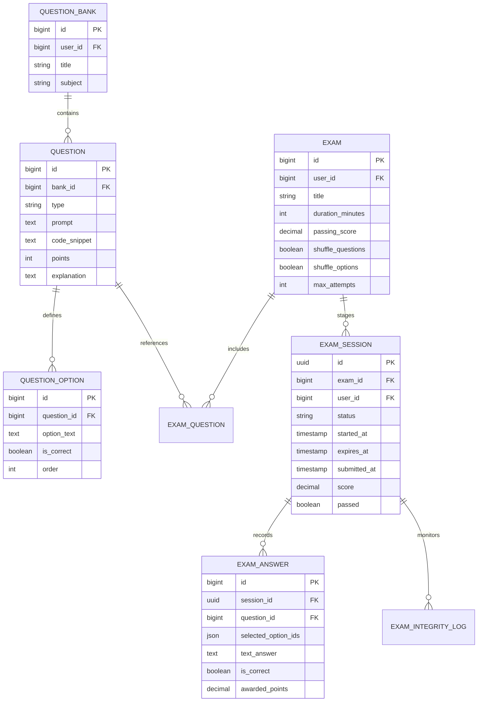
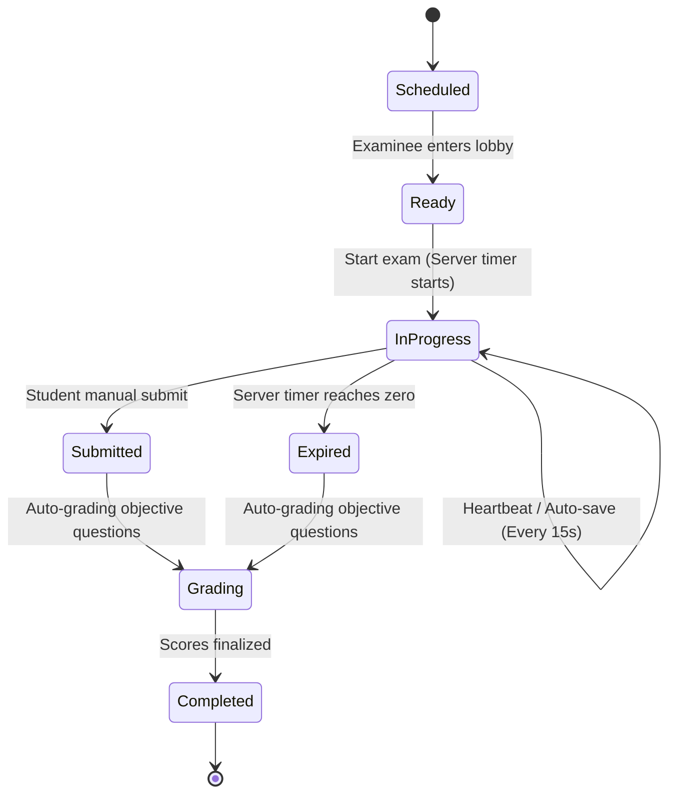

# Dedicated Examination Subsystem Design Specification

## 1. Domain Boundary & Rationale

In strict accordance with the **Architectural Decision**, the Examination System is engineered as an autonomous bounded context. It has its own dedicated database schema, business logic services, state machine, and API endpoints.

**Anti-Pattern Explicitly Prohibited:** Examination questions and answers must NEVER be modeled as special categories or columns inside the `todos` table.

## 2. Core Entities & Data Architecture

## 3. Session State Machine

## 4. Proctoring & Anti-Cheat Heuristics

The subsystem incorporates non-invasive browser-level integrity monitoring:
1. `visibilitychange` listener logs when the examinee navigates away or switches tabs.
2. `fullscreenchange` listener logs unauthorized full-screen exits.
3. Every anomaly is dispatched to `/api/v1/exam-sessions/:id/log-integrity` and stored in `exam_integrity_logs` for instructor audit.

## 5. Network Resiliency & Offline Auto-Save

- Examinee client uses local browser storage (`IndexedDB`) as an append-only store.
- Every selection immediately writes to `IndexedDB` and queues a debounced sync request to the backend.
- In the event of a temporary network outage, questions can still be answered and navigated. As soon as connection restores, all cached answers synchronize seamlessly.

